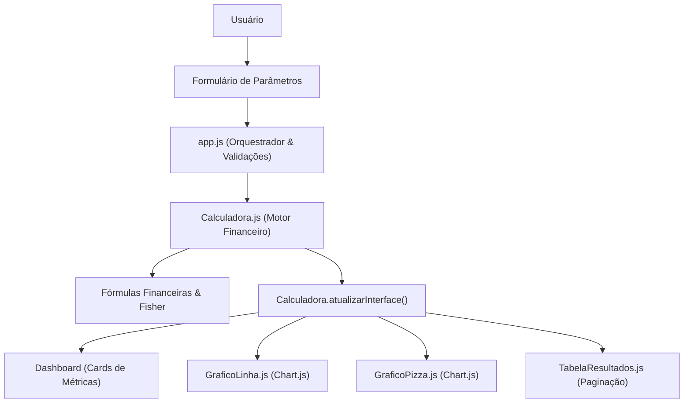

# Arquitetura de Software

Este documento descreve a organização técnica, o fluxo de dados e os módulos que compõem a **Calculadora de Juros Compostos**.

---

## 1. Visão Geral da Arquitetura

A aplicação adota o padrão **Single Page Application (SPA)** desacoplada, orientada a componentes e puramente executada no cliente (*client-side*).

### Diagrama de Fluxo e Componentes

---

## 2. Estrutura de Módulos e Responsabilidades

### `js/app.js` (Orquestrador)
- Inicializa a aplicação e gerencia as máscaras com `IMask.js`.
- Valida entradas de forma defensiva (impedindo estados inválidos, mas aceitando aportes e inflação zero).
- Captura eventos dos botões:
  - **Calcular:** Dispara a simulação.
  - **Exemplo:** Preenche automaticamente um cenário realista e calcula.
  - **Limpar:** Reseta formulários e esconde o painel de resultados.

### `js/components/Calculadora.js` (Motor Financeiro)
- Não manipula eventos de formulário concorrentes (desacoplamento).
- Contém a função pura `calcular(params)` que recebe dados de entrada e retorna o conjunto completo de métricas financeiras.
- Possui o método `atualizarInterface(resultados)` que distribui os dados para os cards, gráficos e tabela.
- Escuta a alternância das abas do Bootstrap para re-renderizar gráficos sob demanda.

### `js/components/graficos/GraficoLinha.js` (Gráfico de Evolução)
- Baseado em **Chart.js 4+**.
- Renderiza 3 séries temporais: Total Investido (aportes), Saldo Bruto Acumulado e Poder de Compra Real (deflacionado).
- Destrói instâncias anteriores para evitar vazamento de memória e sobreposições de canvas.
- Totalmente responsivo para telas móveis e desktop.

### `js/components/graficos/GraficoPizza.js` (Distribuição do Capital)
- Baseado em **Chart.js 4+** (estilo *doughnut*).
- Apresenta a proporção entre Capital Inicial, Aportes Mensais e Juros Acumulados.
- Exibe valores monetários formatados e percentuais nos tooltips interativos.

### `js/components/TabelaResultados.js` (Detalhamento Mês a Mês)
- Renderiza a evolução mês a mês com paginação (12 meses por página).
- Destaca linhas correspondentes ao encerramento de cada ano.
- Possui controle de paginação (primeira, anterior, atual, próxima e última página).

### `js/utils/formatarMoeda.js`
- `formatarMoeda(valor)`: Converte números para o padrão brasileiro `R$ 0.000,00` usando `Intl.NumberFormat`.
- `extrairValorNumerico(valor)`: Faz parsing seguro de strings formatadas para números de ponto flutuante.
- `formatarPorcentagem(valor, casas)`: Formata percentuais com precisão configurável.

---

## 3. Gestão de Estilos e UX/UI

- Estilos foram centralizados em `css/styles.css`.
- O anti-pattern de *hover* que ocultava números nos cards foi substituído por uma tipografia limpa e permanente com subtítulos informativos.
- O card de **Montante Líquido Final** possui destaque em gradiente primário como foco central da simulação.
